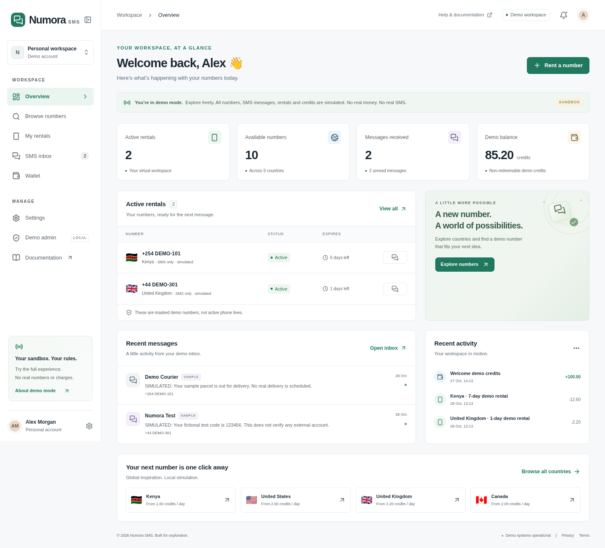

# Numora SMS

**A working, zero-cost virtual SMS number rental simulator—not a telecom service.**

Browse masked demo numbers, rent with fictional credits, create sample messages, cancel/expire rentals and manage inventory. No paid provider, real phone number, payment gateway, database, domain or AI API is required. No credit card is needed to run locally.

> **Security:** If a screenshot exposes a GitHub token, revoke it immediately. Never reuse or paste that token here, in a file, in a remote URL, or in a command. This source does not include or use the supplied screenshot or any token.



## 1. Start locally (beginner-friendly)

1. Install a current Node.js LTS release (Node 22 recommended; minimum 20.9) and Git.
2. Download/extract this project, then open a terminal inside `numora-sms-demo`.
3. Run:

```sh
npm ci
npm run dev
```

4. Open `http://localhost:3000` in your browser.
5. Click **Explore the demo**, then **Rent a number**.

There is **no `.env` requirement**. If you want to customize the brand, copy `.env.example` to `.env.local`, change `NEXT_PUBLIC_BRAND_NAME`, and restart. Keep `APP_MODE=demo`. Do not insert credentials just to try the demo.

Production-mode local run:

```sh
npm run build
npm run start
```

Public pages: `/`, `/pricing`, `/docs`, `/terms`, `/privacy`, `/acceptable-use`.

Workspace: `/dashboard`, `/dashboard/numbers`, `/dashboard/rentals`, `/dashboard/inbox`, `/dashboard/wallet`, `/dashboard/settings`, `/admin`.

## 2. Try the complete workflow

1. Browse numbers, select **Kenya**, search `DEMO-102`.
2. Click **Rent number**, choose 1/7/30 days, confirm the **simulated** cost.
3. Open **My rentals**, then **Inbox** for that rental.
4. Click **Generate sample**; select ordinary text, fictional delivery or test code.
5. Open the sample and check its read state. No network SMS has been received.
6. Open **Wallet** to inspect the rental debit; cancel the rental for one full simulated refund.
7. Try **Simulate expiry** on an active rental. Expiry does not refund credits.
8. Open **Settings** to change profile/theme, retention, delete messages or reset.
9. Open **Demo admin**, read the local-access warning and opt in. Add/edit/disable/remove unused demo numbers; inspect rentals, messages, customer records, ledger and system status. Numbers with rental history can only be disabled, not removed.

The seed has 12 masked numbers across 9 countries, two active rentals, two sample messages and a ledger-derived 85.20 demo-credit balance (100 opening credits minus seeded rental costs). Country, price, duration, availability and search filters operate on actual local state. Daily prices × rental days determine the illustrative cost. Credits are represented as integer minor units (100 units = 1 credit).

## 3. What is—and is not—secure

- Every number contains `DEMO`; none is dialable or represented as active telecom inventory.
- Every sample starts `SIMULATED:`. Test codes are fictional and cannot verify external accounts.
- Demo credits cannot be bought, redeemed, deposited or withdrawn.
- Browser storage is editable, unencrypted, single-persona and not synchronized across tabs/devices. Use one tab for consistent demo state. It is not production money storage.
- Demo persona is not real authentication. Local admin opt-in is not production authorization. It only gates this browser’s sample records and resets on reload.
- Production credentials alone **cannot enable live mode**. Any `APP_MODE` other than `demo` fails validation.
- Live integration POST endpoints always reject requests, do not parse/store/log payloads, and reject cross-origin writes. No live webhook signature is ever accepted.
- Local service ownership checks, safe React encoding, Zod validation, transaction idempotency, error handling and a sample-message throttle are implemented. These do not replace server security.
- Expiration reconciles timestamps on hydration, focus, actions and every 15 seconds; a manipulated device clock can affect it.
- Sample retention defaults to 30 days, configurable from 1 to 90. Cleanup occurs during app use/next visit. Delete individual samples in Inbox or all samples in Settings.
- Activity/audit records contain descriptions/actions, not message bodies or secrets.

See [architecture/threat model](docs/ARCHITECTURE.md) and [production checklist](docs/PRODUCTION-CHECKLIST.md).

## 4. Configuration

| Variable | Required for demo? | Meaning |
|---|---|---|
| `APP_MODE` | No | Defaults to `demo`; all other modes fail closed |
| `NEXT_PUBLIC_BRAND_NAME` | No | Public display brand; never a secret |
| `SMS_PROVIDER` | No | Reserved server-side provider selector |
| `SMS_API_KEY` | No | Reserved server-side credential; unused |
| `SMS_API_SECRET` | No | Reserved server-side credential; unused |
| `SMS_WEBHOOK_SECRET` | No | Reserved server-side signature secret; unused |
| `SUPABASE_URL` | No | Future server configuration; unused |
| `SUPABASE_SERVICE_ROLE_KEY` | No | Future privileged server key; unused |

Only the brand is allowed a `NEXT_PUBLIC` variable. Never put secrets in browser JavaScript, Git, build logs, screenshots, error responses or public environment names. `.gitignore` excludes `.env*` except `.env.example`.

## 5. Architecture & future database

Next.js App Router + strict TypeScript, React, Tailwind CSS, accessible native controls/dialogs, Lucide, React Hook Form and Zod. CSS does not rely on external fonts or CDNs. Exact dependency versions and a lockfile are included.

The UI, application services, storage adapter, provider/authentication contracts, validation and types are separate modules. NumberProvider defines discovery/details/reserve/release; MessagingProvider defines reads/validation/incoming handling; PaymentProvider defines checkout/verified-webhook/refund. Demo adapters never perform real-world operations. Payment methods and real auth return an explicit not-configured error.

`supabase/migrations/202610280001_initial.sql` prepares all 12 requested tables, indexes, enum/check/unique constraints, tenant RLS, column-restricted customer updates and a service-only, wallet-locking idempotent ledger function. It is **not connected to the demo**. Local PGlite tests execute it with mocked Supabase roles/auth and test basic RLS/ledger permissions. This is not a real Supabase deployment or proof of concurrent production safety. Run against a disposable Supabase instance, review grants, and test real identities before use.

Full atomic server rental/provider reservation, payment/refund verification, distributed rate limiting, secure sessions and retention jobs remain future production work. The checklist makes these requirements explicit.

## 6. Tests & checks

```sh
npm run lint
npm run typecheck
npm test
npm run build
```

For browser tests, install Chromium (Linux may need administrator permission for system libraries):

```sh
npx playwright install --with-deps chromium
npm run start
# In another terminal, with the production server running:
npm run test:e2e
```

Playwright tests desktop Chromium and mobile-sized Chromium (iPhone viewport, **not real Safari**). They cover the full rental/message/wallet/cancellation flow, reload persistence, admin inventory, responsive pages, disabled integration endpoints and automated WCAG A/AA scans on essential pages. Automated scans are not full accessibility certification. The CI workflow runs the same checks after publishing.

See [verification report](docs/VERIFICATION.md) for actual run results and external blockers.

## 7. Publish to PUBLIC GitHub repository `numora-sms-demo`

**Current status: local Git commits only. No repository has been created or pushed from this execution.** The Arena GitHub connector returned `unsupported`, no GitHub CLI was installed and no private GitHub credential was provided. No remote account identity or repository URL has been fabricated.

### Supported secure authorization on your computer

1. Revoke the exposed token through GitHub → Settings → Developer settings → Personal access tokens.
2. Install [GitHub CLI](https://cli.github.com/) on your own computer.
3. In a local terminal run:

```sh
gh auth login --hostname github.com --git-protocol https --web
```

Choose browser login, approve the device/browser authorization on GitHub, and let GitHub CLI manage credentials. **Do not choose to paste a token into chat or put one in source.** If the OS cannot provide secure credential storage, configure Git Credential Manager/your OS keychain or use an authorized SSH key before proceeding.

4. In the extracted source directory, set your own commit identity locally if needed. The source archive excludes `.git`; the provided Git bundle optionally preserves the verified local commits. For a fresh repository:

```sh
git init -b main
git add .
git commit -m "feat: add Numora SMS demo with tests and deployment docs"
gh repo create numora-sms-demo --public --source=. --remote=origin --push
```

If `numora-sms-demo` already exists, stop and inspect it before adding a remote; do not force-push or overwrite another project. If using the supplied Git bundle instead, clone it into a new directory, remove the bundle `origin` remote, and use `gh repo create` from that cloned directory.

5. Verify the actual authorized repository, visibility, default branch and remote commit:

```sh
gh repo view --json url,visibility,defaultBranchRef
git rev-parse HEAD
git ls-remote origin refs/heads/main
git status --short
```

The local and remote commit hashes must match. The expected name is `numora-sms-demo`, visibility PUBLIC, branch `main`. Report the actual `url` returned by GitHub—not a guessed username.

If Arena later offers a GitHub connection, use its connected-app browser authorization flow and grant repository creation/write permission. This session cannot enable an unsupported connector by using the exposed token.

## 8. Vercel deployment (prepared, not performed)

1. Publish to GitHub using the steps above.
2. Sign in to [Vercel](https://vercel.com/) through its website. Use Hobby only if this is a personal, non-commercial demo eligible under its terms.
3. **Add New → Project → Import Git Repository**. Authorize Vercel’s GitHub App for this repository, select `numora-sms-demo`.
4. Root directory: repository root. Framework: **Next.js**. Node: **22.x**. Install: `npm ci`. Build: `npm run build`. Leave output directory at the Next.js default.
5. No credentials are needed. Optionally set `APP_MODE=demo` and `NEXT_PUBLIC_BRAND_NAME=Numora SMS`. Do not add SMS/Supabase credentials for this demo.
6. Deploy. A provider-generated `vercel.app` address avoids purchasing a domain. The address is only real after Vercel reports a successful deployment.
7. Open the assigned HTTPS URL and perform the full journey in section 2, including refreshing a nested route, creating samples, checking refunds and local reset. Verify mobile layout and demo notices.
8. After environment changes, trigger **Redeploy**: public brand variables are compiled at build time. No redirect/rewrite configuration is required for Next.js App Router.

No Vercel token should be pasted into chat, committed or stored in browser code. No Vercel deployment was attempted with an unauthorized account, and no public live URL is claimed.

### Free-tier boundaries (official pages checked 28 October 2026)

- [Vercel Hobby](https://vercel.com/docs/plans/hobby): personal **non-commercial** use only; includes 100 GB Fast Data Transfer, 10 GB Fast Origin Transfer, 1 million CDN requests, 1 million function invocations, 4 active CPU-hours and 360 GB-hours provisioned memory. Usage limits can pause features; not unlimited hosting. Recheck current terms and dashboard quotas before deployment. Commercial operation needs a permitted plan.
- [Supabase Free](https://supabase.com/pricing), **optional and unused**: 500 MB database, 5 GB egress plus 5 GB cached egress, 1 GB file storage, 50,000 monthly active users, two active projects; free projects pause after one week of inactivity. No production uptime or unlimited resource promise.
- Local demo costs nothing beyond your own device/connectivity. Hosted account verification and eligibility remain controlled by the providers; do not assume their onboarding requirements are fixed.

### Troubleshooting

- **`npm ci` fails:** use Node 22 LTS, ensure the lockfile is present and retry with a working registry connection. Do not replace exact versions blindly.
- **Mode validation error:** remove `APP_MODE=production/live`; this release intentionally supports only `demo`.
- **Port 3000 busy:** stop the other app or run `npm run dev -- --port 3001`. Browser tests expect port 3000 unless you edit `playwright.config.ts`.
- **Missing Chromium/Linux libraries:** run `npx playwright install --with-deps chromium`; administrator permission may be needed for OS dependencies, never for telecom credentials.
- **Tests time out:** build, run `npm run start` separately, confirm `http://localhost:3000` opens, then run browser tests. They do not auto-start a server.
- **Local data looks stale/corrupt:** Settings → Reset entire demo, or clear this origin’s local storage. Browser and domain changes have separate storage.
- **Credits/history differ across tabs:** multi-tab conflict resolution is not implemented; use one tab and reset to restore deterministic seed relationships.
- **Storage blocked/full:** a warning appears; changes remain in memory until the tab closes. Try a browser/profile with local storage enabled.
- **Vercel import missing:** authorize the GitHub App for the actual repository and check owner/org approval. Do not embed tokens in remote URLs.
- **Vercel build fails:** inspect build logs for Node version or invalid mode. Default Next.js build settings are sufficient; no backend credentials are required.
- **Webhook/payment returns 503:** intentional. No live integration is configured. Do not treat this as an error to bypass.

## 9. Remaining accounts, resources and approvals

**For local use:** none besides a Node-capable device. Internet access is needed once to install packages/browser binaries.

**For publication:** authorized GitHub account/browser login; actual public repository creation and push; remote verification.

**For hosted demo:** authorized Vercel account, GitHub App import approval, eligible plan, successful build and deployed HTTPS verification.

**For real operations:** legitimate SMS provider account and resale permission, supported inventory (usually paid), production database/authentication, compliant hosting plan, verified payment processor if charging money, legal/regulatory review, secure server implementation, independent security testing and ongoing operations. These are not included or represented as complete.
